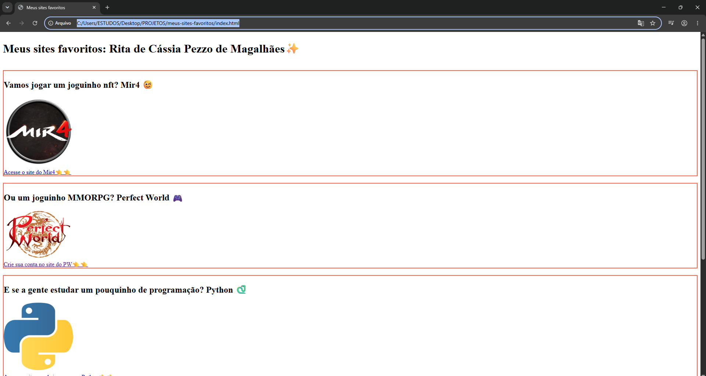
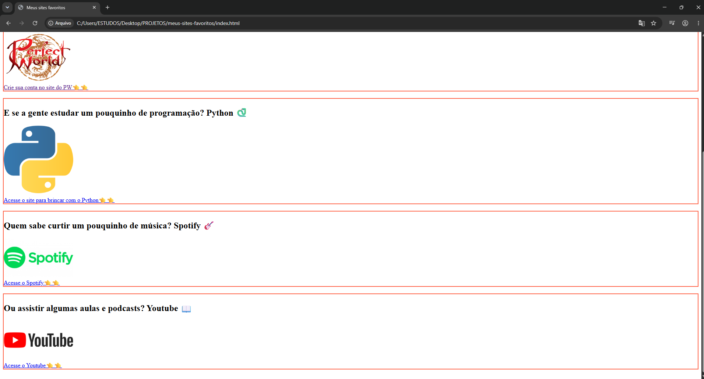

# Atividade proposta pelo curso de Desenvolvimento de Sistemas - Agenda 12 
## Outubro de 2026
# Centro Paula Souza (ETEC)

## Título: Meus Sites Favoritos
# 🚀Objetivo:
## Criar uma página Web utlizando html, inserindo 5 logos e links clicáveis utlizando o conteúdo estudado na Agenda 12.
## Inserir comentários no código com informações sobre cada tag utilizada.
 
 

     Utilizei emojis para tornar os títulos mais
     divertidos e facilitar a identificação
     dos assuntos apresentados na página 🤗

## Pagina funcionando:

     
    
